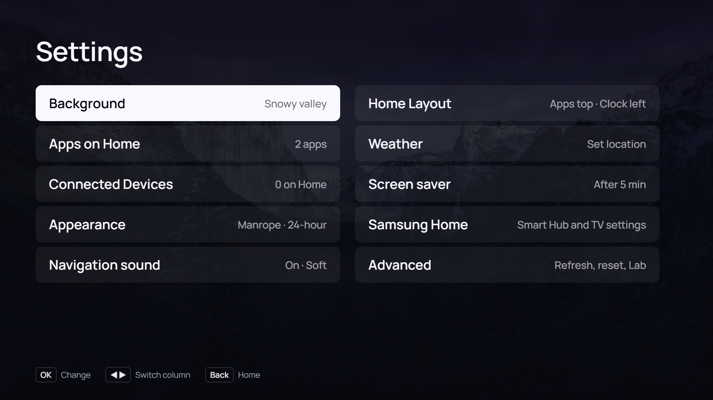
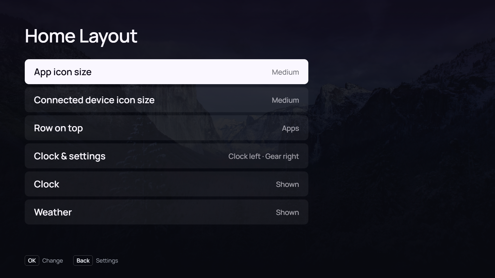
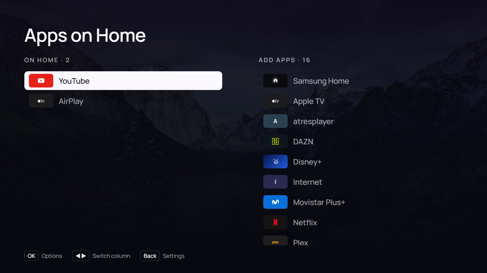
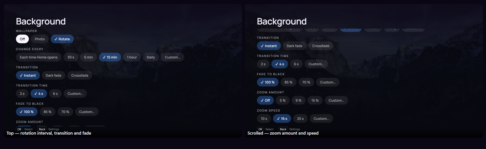
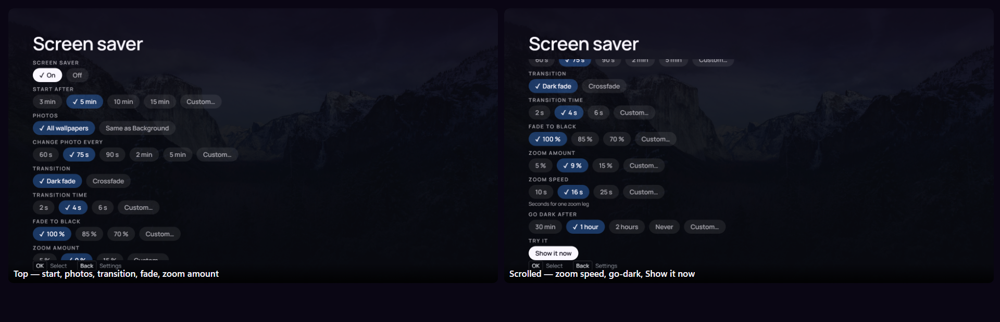
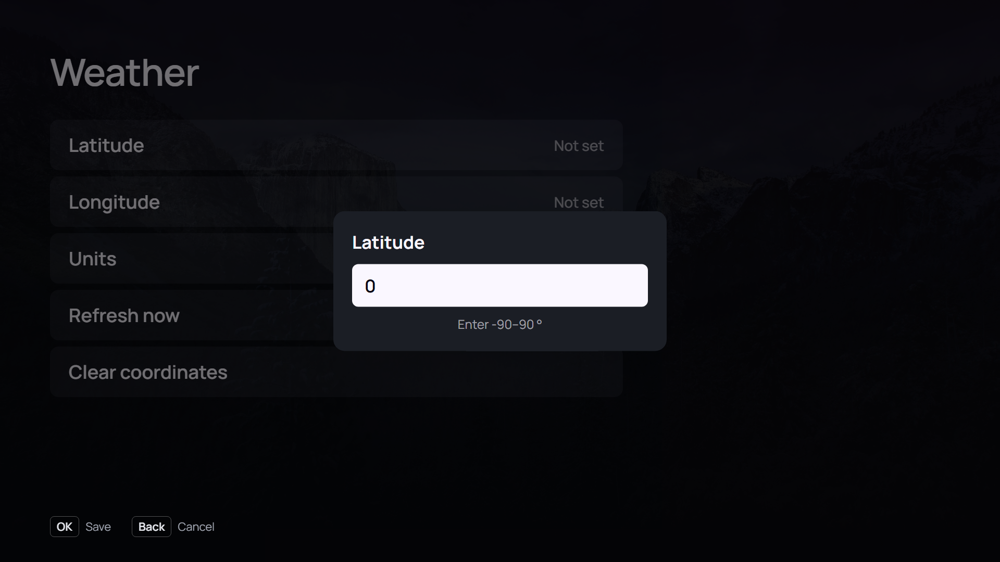

# Arn0 Launcher — TV fork

A fork of the Arn0 launcher (MIT) for a Samsung Tizen TV: a 1920×1080, remote-only web app.
Current package: `TvLaunch01.Launcher` **0.6.25**.

**Compatibility.** Upstream Arn0 targets **Tizen 6.5** (Q70B, Chromium 85). This fork was tested on
a **QE65QN95A** (`T-NKM2DEUC-2310.0`, Tizen 6.0) with **Chromium 110.0.5415.0 / 120.0.6099.5**,
mounted at boot by `/usr/bin/chromium-efl-install` from
`/opt/usr/apps/org.tizen.chromium-efl/res/chromium-efl.img` — the staged upgrade copied from
`/opt/usr/apps/org.tizen.chromium-efl-upgrade/res/chromium-efl.img`.


## Fork changes

- **Connected Devices** — the Home row discovers live HDMI ports from `VIDEOSOURCE` and shows
  unconfigured ones as `HDMI n`; Settings ▸ Connected Devices names, logos, opens, hides or
  reorders them.
- **Brand marks** — Apple, Wii U, Windows, Linux and USB added to the logo picker.
- **Samsung Home shortcut** — Apps on Home can add a Samsung Home tile using the supplied logo;
  it launches `com.samsung.tv.csfs`, the same action as Settings ▸ Samsung Home.
- **Home restyle** — hero/low-rails layout, smaller clock, and a trimmed Home row (TizenTube as
  YouTube, AirPlay, All apps).
- **Background motion** — the same Instant / Dark fade / Crossfade, transition time, fade depth
  and zoom amount/speed controls as the screen saver, plus a Custom rotation interval. Defaults
  stay Instant/Off until you opt in.
- **Home Layout** — Small/Medium/Large app and device tile sizes, choose which row is on top,
  swap the clock and settings sides, and hide the clock or weather.
- **Screen saver** — breathing zoom with adjustable amount and speed, Dark fade or Crossfade
  (depth and duration), 2/5 min photo intervals, and Custom numeric fields; the settings page
  scrolls with the remote.
- **Weather** — Settings ▸ Weather sets latitude/longitude, °C/°F, automatic refresh every
  15/30/60/180 min (or Custom), Refresh now and Clear. A compact reading appears under the Home
  clock and in the screen-saver corner; optional named presets can be supplied in the gitignored
  `config.local.js`.
- **The 60 s fix** — the screen saver is a slideshow by default (All wallpapers), so a photo
  interval works even when Home holds a single photo.

No new Tizen privileges.

## Preview

**Settings**



**Home Layout**



**Apps on Home**



**Background**



**Screen saver**



**Weather**



**Custom values and dark fade**


## Install

The app installs as an ordinary Tizen web app; the native Home/startup helper is not published
in this fork. See [docs/setup-tv.md](docs/setup-tv.md).

```sh
npm run preview   # browser preview at http://localhost:8080
npm run build     # dist/arn0-launcher.wgt (requires sh + zip)
```

Signing and deployment happen outside this repository.

## Docs

- [docs/FORK-CHANGES.md](docs/FORK-CHANGES.md) — complete upstream-vs-fork comparison.
- [docs/setup-tv.md](docs/setup-tv.md) — install and Home-button notes.
- [src/img/marks/SOURCES.md](src/img/marks/SOURCES.md) — brand-mark provenance.

## Licence

MIT. Bundled fonts (OFL), Unsplash photos and brand marks keep their own terms; trademarks
belong to their owners. Based on the Arn0 launcher (MIT).
