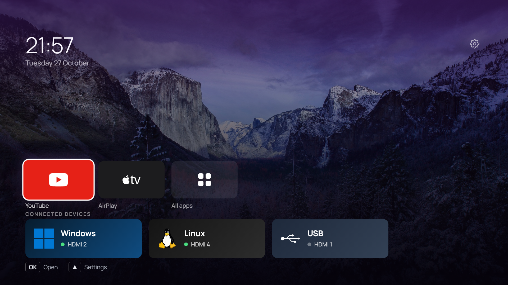
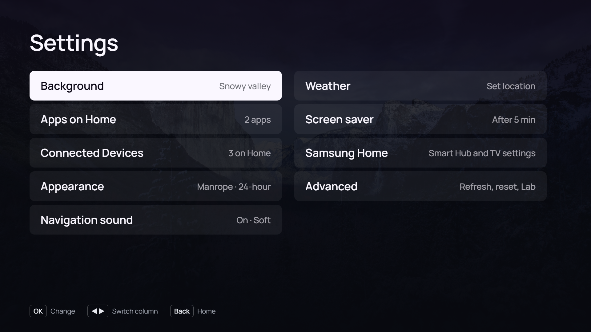
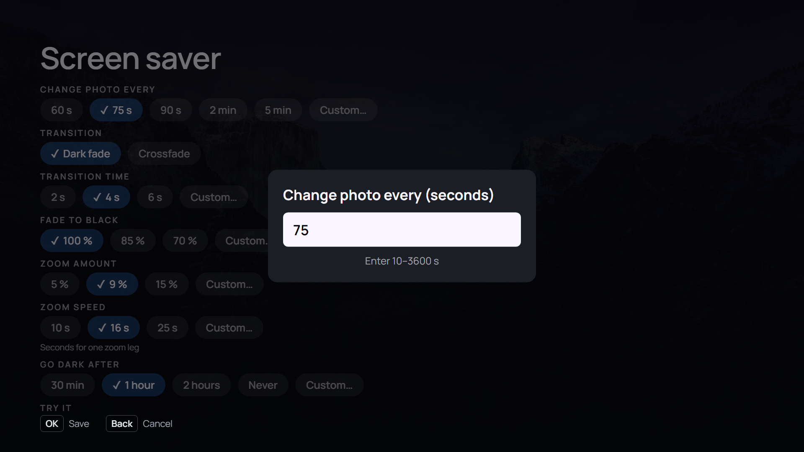
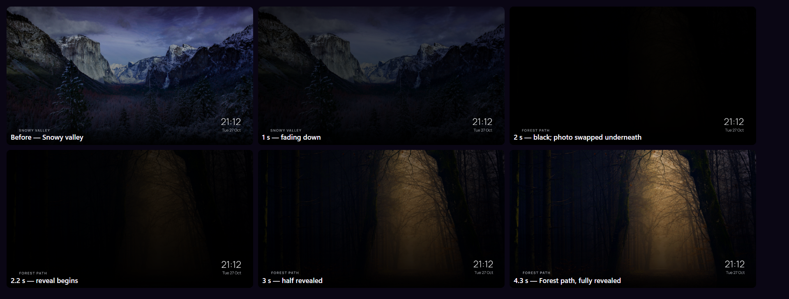

# Arn0 Launcher

A quieter home screen for a Samsung Tizen TV: a clock, a row of your apps, a row of your connected
devices, and nothing else.


*The browser preview, with the bundled Manrope font and the "Milky Way" wallpaper.*

I built this for one TV in my living room, a Samsung Q70B on Tizen 6.5, because its own home
screen had become a shop. It does what I want: the apps I use, the devices I own, driven by the normal remote. I am sharing it as a starting point rather than a product.

**Use it at your own risk.** The optional Home-button setup changes TV preferences that Samsung
does not document. See [the setup guide](docs/setup-tv.md) before using it.

## Recommended approach

I highly recommend forking it and building on top of it, ideally with a coding agent that can help
you understand and adapt the setup. Start with the browser preview, make the interface your own,
then work through TV installation when you're ready. Native Home/startup changes need particular
care; [the setup guide](docs/setup-tv.md) covers the risks and recovery steps.

## Try the interface

Needs Node.js 20 or newer. Nothing is installed and no TV is involved.

```sh
git clone https://github.com/<you>/arn0-tv.git
cd arn0-tv
npm run preview        # http://localhost:8080
```

Navigate with the arrow keys and Enter; Esc or Backspace is Back; `R` `G` `Y` `B` are the remote's
colour keys. `#all` and `#lab` in the URL open those screens directly.

The preview runs against [`src/js/tizen-mock.js`](src/js/tizen-mock.js), a stand-in for the Tizen
APIs that is inert on the TV itself. So the layout, focus behaviour, settings, fonts and wallpapers
are all real, while launching apps and switching HDMI inputs only do something on a real TV.

## What you can change

Everything in [`src/js/config.js`](src/js/config.js) is meant to be edited: which apps appear, which
devices and on which HDMI ports, how an input tile switches the TV, the locale, the starting
wallpaper. Most of it is also editable from the launcher's own Settings once it is on the TV, and
the TV's copy wins (`config.js` only supplies the defaults).

Beyond config: tile colours and brand marks in [`src/js/brands.js`](src/js/brands.js), the whole
look in [`src/css/style.css`](src/css/style.css), and your own photos as wallpapers.

Weather coordinates can be set in **Settings ▸ Weather** on the TV, or supplied as defaults in
`src/js/config.local.js` (which also takes a devlog address). `config.local.js` is gitignored and
merged over `config.js` one level deep, so the tracked file keeps its nulls while the local one
reaches both the browser preview and the packaged `.wgt`. Nothing to strip before a push, nothing
to restore before a build. Copy [`config.local.example.js`](src/js/config.local.example.js) to
start.

## Coding agent prompt

This project was largely built with coding agents, and adapting it is a reasonable thing to hand to
one. A starting prompt that keeps the agent on the safe side of the line:

```
This is a Tizen TV launcher (see README.md). Work in the browser preview only.

Do: edit src/js/config.js, src/js/brands.js and src/css/style.css; run `npm run preview`
and check the result; keep the 1920x1080 stage and remote-only navigation intact.

Do not: connect to a TV, run sdb, sign or install a package, or touch anything
under native/. Do not change Home or startup behaviour.
```

TV work is different in kind: it needs a machine on the same network as the TV, so an agent that
can only read this repo cannot operate the TV. This repository includes the guarded helper source,
but does not include a ready-to-run SDB staging/runner script or a per-TV recovery snapshot.

## Put it on a TV

**[docs/setup-tv.md](docs/setup-tv.md)** — installing the package, then optionally the Home button
and power-on changes, with the recovery steps for each.

Installing the launcher is reversible by uninstalling it. The Home-button change is reversible
with the saved per-device baseline, but it rewrites undocumented platform preferences. The
launcher works fine without that change, open it from the app list like any other app.

**This public fork publishes the web app only.** The guarded native Home/startup helper and the
per-device baseline are intentionally not in the repository, so the native half of the setup guide
is reference material; the launcher installs and runs as an ordinary web app without it.

Evidence and limits:

| | |
| --- | --- |
| Reference device | QE65Q70BATXXC (Q70B, 2022), firmware T-PTMDEUC-1720.7, Tizen 6.5, armv7 |
| Install | `.wgt` via Apps2Samsung or Tizen Studio CLI; works |
| Home button | Tested on the reference device: opens `Arn0Lnchr0.Launcher` |
| Power-on | `auto_start` was `1` and remains `1`; the helper does not change it. Cold-boot behaviour has not been independently validated as part of the Home-button change |
| Method | Developer Mode, UID 901, platform `vconf` / `aul` calls. **No root.** |
| Open items | Untested on `auto_start=0` TVs; behaviour after a firmware update unknown |
| Other models | **No compatibility claim.** The helpers check architecture, UID, and firmware string, but do not verify the TV model |

## Reference

### Commands

```sh
npm run preview      # browser preview on :8080
npm run build        # -> dist/arn0-launcher.wgt
npm run devlog       # receive Lab logs from the TV into logs/tv.jsonl
node scripts/prepare-wallpapers.mjs <folder>   # regenerate wallpapers from your photos
```

### Remote

| Key | Action |
| --- | --- |
| Arrows | move (Up from the apps row reaches the gear = Settings) |
| OK | open app / switch input / select |
| Back | one level back (does nothing on Home) |

Hidden shortcuts: Red = All apps, Green = next wallpaper, Yellow (in All apps) = show system apps,
Blue = Lab. On Home, Left and Right alternating three times (◀ ▶ ◀ ▶ ◀ ▶) starts the hidden game;
OK / Up jumps, Down ducks, Back returns Home. The code alternates rather than repeating a key
because a held remote key auto-repeats, which would both break a run-based code and fire it by
accident while sweeping along a row.

### Layout

```
src/                  everything that goes into the .wgt
  config.xml          Tizen manifest (app id, privileges)
  css/style.css       1920x1080 stage; performance rules measured, not assumed (see its header)
  fonts/              Manrope, Inter, Outfit, DM Sans (OFL), bundled so nothing loads from the network
  img/marks/          brand marks (Simple Icons CC0, Custom Brand Icons MIT; see SOURCES.md)
  img/tiles/          marks recoloured per brand (generated at build)
  img/wallpapers/     1920x1080 wallpapers with the readability scrim baked in (generated)
  js/config.js        your apps, devices, HDMI method, locale, theme
  js/config.local.js  gitignored per-TV overrides, merged over config.js (not in the repo)
  js/brands.js        tile colours and marks per brand
  js/apps.js          list / filter / launch via tizen.application
  js/inputs.js        HDMI discovery via tizen.systeminfo + switching via tizen.tvwindow
  js/wallpaper.js     wallpaper display and rotation
  js/screensaver.js   idle screen saver: photos, breathing zoom, clock
  js/appearance.js    clock, date and font settings
  js/weather.js       Open-Meteo reading for the screen saver corner
  js/prefs.js         settings saved on the TV
  js/ui.js            screens, focus, keys, toast, pop-up menu
  js/home.js          Home, All apps, Lab
  js/settings.js      Settings pages
  js/devlog.js        development log (Lab screen, optional upload to your computer)
  js/render-probe.js  measures what this TV can actually render (Lab screen only)
  js/platform-probe.js  reports which tizen.* / webapis.* APIs the TV exposes (Lab screen only)
  js/boot.js          start-up
  js/tizen-mock.js    fake Tizen APIs for the browser preview (inactive on the TV)
scripts/              build-marks.mjs, build.sh, serve.mjs, devlog-server.mjs, fetch-assets.mjs, make-icon.mjs
docs/                 setup guide, fork changes
```

The optional native Home/startup helper is kept out of the public fork: the launcher installs as an
ordinary web app. The native half of docs/setup-tv.md is retained from upstream for reference.

### Settings

Saved on the TV in `localStorage`. They survive restarts and in-place updates, not an uninstall.

- **Background** — Off (plain gradient), one photo, or rotate: on each Home, 30 s, 5 min, 15 min,
  1 hour, daily.
- **Apps on Home** — OK on an app opens Move / Remove; OK on the right-hand slot adds one.
- **Connected Devices** — per input: rename (on-screen keyboard), HDMI port, logo
  (PlayStation, Xbox, Switch, Wii U, Windows, Linux, USB, Apple, None), how it opens, hide,
  reorder, remove; plus add a device. Connected HDMI ports the TV reports but that are not in the
  list appear here as **Detected · connected**, so they can be named without guessing the port.
- **Appearance** — 24/12-hour clock, date shown/hidden, date language (English, Español, Français),
  font, app names (always / when selected / never).
- **Navigation sound** — turn arrow-key sounds on or off, choose Soft, Warm or Bright, and preview
  the selected tone.
- **Weather** — latitude, longitude, Celsius/Fahrenheit, refresh now and clear. Coordinates are
  stored on the TV and override `config.js`; the reading appears in the screen saver corner. Named
  presets supplied in `config.local.js` appear as rows above Latitude.
- **Screen saver** — on or off, start after 3/5/10/15 min idle on Home, **Photos: All wallpapers
  / Same as Background**, change photo every 60/75/90 s or 2/5 min, transition **Dark fade** or
  **Crossfade**, transition time 2/4/6 s, **Fade to black**, **Zoom amount**, **Zoom speed**, go
  dark after 30 min / 1 hour / 2 hours / never, and show it now. Every numeric value has a
  **Custom…** field for an exact number.
- **Samsung Home** — opens `com.samsung.tv.csfs`, from which TV settings are one press away.
  Opening `com.samsung.tv.coba.setting` directly does not work on this TV. Keep this entry: it is
  the route back if you have redirected the Home button.
- **Advanced** — refresh the app list, export settings to the log, reset everything, Lab.

### Wallpapers

Photos are cropped to 1920x1080 and darkened (top-left for the clock, bottom for the tiles) at
build time, so the TV only ever draws one plain JPEG on its own layer. Drop photos in a folder and
run `node scripts/prepare-wallpapers.mjs <folder>`; friendly names and crop positions for known
files live in that script. Current photos are from Unsplash; credits appear when you switch with
Green.

Home rotation swaps a preloaded photo directly, with no blend. The screen saver's photo change has
its own transition and timing (below), because a slow change there is the effect you actually sit
and watch.

### Screen saver

After a few minutes with no input on Home it shows the wallpapers full screen with the clock, the
weather and the photo's name in the corners. Any button closes it, and that press does nothing else. It never
appears over a console input, another screen or the hidden game.

A photo change is either a **Dark fade** (the default) or a **Crossfade**, chosen in Settings ▸
Screen saver. Dark fade takes half the transition time to dim the picture to black, swaps the
photo underneath the black layer, and uses the other half to reveal it; the clock and caption sit
above the black layer and stay readable. Crossfade overlaps the outgoing and incoming photos
directly. **Fade to black** controls how dark the dark fade goes (100% is true black); **Zoom
amount** and **Zoom speed** control the breathing zoom. The interval between photos defaults to
75 s; the transition defaults to 4 s.

**Photos** decides what the screen saver cycles. It defaults to **All wallpapers**, so the screen
saver is a slideshow regardless of what Home is showing — this is what makes a short interval
work even when Background is a single photo. **Same as Background** is the older behaviour: Off
leaves just the clock, Photo holds the chosen picture, Rotate cycles. The screen saver keeps its
own position, so it never rewrites the wallpaper Home comes back to.

The weather is off until coordinates are entered in **Settings ▸ Weather** (or supplied as
defaults in `config.js` / `config.local.js`). It comes from
[Open-Meteo](https://open-meteo.com/), which needs no API key. Latitude and longitude accept four
decimal places, and the page also chooses Celsius or Fahrenheit, fetches a reading on demand and
can clear the coordinates. The reading is cached in `localStorage` so the screen saver opens with
real numbers even after the TV has been off, it refreshes at most once an hour and only when
something is about to show it, and anything older than three hours is treated as no reading at
all — an unattended screen should go blank rather than state yesterday's temperature as if it
were now.

Everything in it moves, because a clock parked in one corner for an hour is a burn-in risk: the
photo breathes — by default it zooms in 9% over 16 seconds, then back out over 16 seconds,
repeating — with a small sideways drift so the centre of the picture is not static either. The
corner text shifts a few pixels on each photo change, the clock moves to another corner every two
and a half minutes, and the whole thing fades to black once the configured hour is up.

Every numeric value in Settings ▸ Screen saver has preset chips plus a **Custom…** field. The
Custom field opens the TV's on-screen keyboard, accepts one decimal place, and validates the
range (for example 10–3600 seconds for the photo interval, 0–100% for the fade). Custom values are
stored as plain numbers, so they survive restarts like any other setting.

Black, rather than off, because a web app cannot turn this panel off: `tizen.power` and
`webapis.power` are both absent on the reference TV, which **Platform probe: what APIs this TV
exposes** in the Lab screen will confirm on yours. No privilege changes that — an absent API gives
you nothing to be refused by. A real power-off is the TV's own Eco Solution ▸ Auto Power Off,
driven by the same absence of remote input that started the screen saver.

Only `transform` and `opacity` animate, which the compositor can run without repainting. The
upstream launcher, built for a Q70B on Chromium 85, panned instead of zooming because that engine
re-rasterised a scaled layer in visible steps. This fork's TV runs the upgraded Chromium 110/120
engine, so the zoom is back: **Zoom amount** (default 9%) and **Zoom speed** (default 16 s per
leg) in Settings ▸ Screen saver tune it. The layer is laid out a little larger than the screen, so
1.09× and the 42 px drift never show an edge. If a different panel does step, lower Zoom amount (a
smaller scale is cheaper to composite) or go back to the translate-only drift.

### Apps

`getAppsInfo` reports many internal services as visible, so **All apps** keeps only ids that look
like store apps (`AbCdEfGhIj.Name`, or numeric) plus a short list of preinstalled consumer apps, and
drops names containing service/worker/agent/e-manual. Yellow shows everything when you need to find
something. The id of the focused app is shown bottom-left — pin it in `config.js` as `{ id: '...' }`,
which is more reliable than a name match.

### HDMI inputs

`tizen.systeminfo.getPropertyValue('VIDEOSOURCE')` lists the ports and `tizen.tvwindow.setSource()`
changes the source (privilege `tv.window`, public). What happens next is undocumented, so
`inputMethod` has three options:

- `switch+viewer` (default) — set the source, then open Samsung's TV viewer, so the console is shown
  by the TV itself with Game Mode and friends as usual.
- `switch` — only set the source.
- `inapp` — show the input full screen inside the launcher; Back returns to the dashboard. Probably
  no automatic Game Mode or VRR this way.

The **Lab** screen (Blue) tries each method per input and reports what happened. The dot on each
tile is green when the TV reports that port as connected.

The row is not limited to configured devices. `config.js` ships `inputs: []`, which used to leave
the row empty; the launcher now reads `VIDEOSOURCE` itself and shows every connected HDMI port as
`HDMI n` (with a neutral screen glyph) even if it was never configured. It re-reads the list when
Home is shown and every 30 seconds, so a device plugged in later appears without a restart, and an
unplugged one disappears. Settings ▸ Connected Devices lists those ports as **Detected · connected**;
opening one names it and turns it into a normal device entry (name, logo, method, hide/reorder).
A configured entry always wins over auto-detection for the same port.

To collect Lab results on your computer, point `devLogUrl` in `config.js` at it and run
`npm run devlog`; entries land in `logs/tv.jsonl`. Set it to `null` to disable, which is the
sensible setting for a TV you are not actively debugging.

### What the hardware can afford

The TV will not tell you what it can render, so the Lab screen measures it. **Render probe:
everything** walks a focus ring along eight tiles — the same work as moving along the apps row —
and counts frames against the wall clock for each of four stages. Results land in the log.

On the reference Q70B (Chromium 85, 4 cores, 2 GB), baseline is 59.5 fps / 16.8 ms with no
dropped frames, and:

| | Measured | |
| --- | --- | --- |
| Blurred `box-shadow`, 8 tiles at `0 40px 100px` | 59.5 fps, 0 dropped | free |
| 3 live radial-gradient layers, 1100 px | 4.6 fps, 178.7 ms, 88/90 dropped | never at runtime |

So soft shadows are fine and background glows are not. Bake a gradient into the wallpaper at
build time instead — `scripts/prepare-wallpapers.mjs` already does exactly this for the
readability scrim.

The probe also reports the engine and its CSS support, which saves guessing: Chromium 85 has
grid, gap, sticky and `clamp()`, but no `inset`, `aspect-ratio`, `overflow: clip`, individual
transform properties, `color-mix()`, container queries or `:has()`.

Re-run it on your own TV before trusting any of these numbers; that is the whole point of it.
Two of my own early runs produced nonsense — `requestAnimationFrame` on this engine stops
tracking vsync and fires callbacks in batches, which reads as absurdly high frame rates, so the
probe now measures against `Date.now()` and flags any sample faster than the panel refreshes.

### Privileges

| Privilege | Used for |
| --- | --- |
| `application.launch` | opening apps and the TV viewer |
| `application.info` | listing apps |
| `tv.inputdevice` | colour keys (arrows, OK and Back need no registration) |
| `tv.window` | HDMI source switching and display |
| `internet` + `<access origin="*">` | the Open-Meteo request and the development log |

## Contribute

Forks and experiments are welcome. If you report a problem, include your model, firmware and what
you actually observed, and strip local addresses and device identifiers first.

What I would find most useful: results from other models and Tizen versions, and especially from a
TV where `db/menu/smart_hub/ontvsetting/auto_start` starts at `0`.

## Local restyle and additions (this fork)

Installed on the TV as `TvLaunch01.Launcher` **0.6.21** (signed build; `dist/` is gitignored).

The complete upstream comparison — new features, changed behaviour and what is deliberately not
published — is in **[docs/FORK-CHANGES.md](docs/FORK-CHANGES.md)**.

The Home screen was restyled to a "hero + low rails" composition: a full-bleed
hero with a static rose/violet veil, a smaller clock, and two low shelves whose
headings are hidden. Everything is scoped to `#home`, so the Settings tiles and
the All-apps grid keep their original sizes.

- `src/index.html` — Home markup, with the existing clock, gear, apps and input IDs kept.
- `src/css/style.css` — the appended **"Hero restyle"** block at the end of the file.
- `src/js/config.js` — default wallpaper `valley-snow`; Home `apps` trimmed to
  TizenTube (shown as "YouTube") and AirPlay. Xbox, TizenBrew and Samsung TV Plus
  were removed from Home; TV Plus is also disabled at TV level. TizenBrew remains
  in All-apps.
- `src/img/marks/{apple,wiiu,windows,linux,usb}.svg` — added marks, selectable per
  input in Settings ▸ Connected Devices ▸ Logo. Wii U, Windows and Linux are copied
  as-is because their colours are part of the mark; the others are recoloured per
  brand at build time; `scripts/build-marks.mjs` supports a `precolored` brand.

The default wallpaper only applies to a fresh install; an existing TV keeps its
saved choice, so change it in **Settings ▸ Background**. Preview with
`npm run preview`, then rebuild and sign as usual before deploying.

### 0.6.20 — Connected Devices, weather coordinates and more marks



*Home: the second row is now headed **CONNECTED DEVICES**, with the new Windows, Linux and USB
marks alongside the existing set.*

- **Connected Devices.** The Home row heading and the Settings page are now named **Connected
  Devices** (the internal view and app IDs are unchanged). The page still holds consoles and
  detected HDMI inputs; only the user-facing name changed.
- **Weather settings.** Settings ▸ **Weather** now takes latitude and longitude (four decimal
  places), Celsius/Fahrenheit, refreshes on demand and can clear the coordinates. Values are stored
  in the launcher's prefs on the TV, override `config.js`, and appear in the screen saver corner.
- **More marks.** **Windows**, **Linux** (Tux) and **USB** were added to the logo picker, alongside
  **Apple** and **Wii U**. Windows and Linux keep their own colours; USB is recoloured per brand at
  build time.
- **Screen saver motion and transition.** The photo breathes by **Zoom amount** (default 9%) at
  **Zoom speed** (default 16 s per leg), changing with **Dark fade** (default) or **Crossfade**
  over **Transition time**. **Fade to black**, the photo interval, start delay and go-dark time all
  have **Custom…** numeric fields.
- **The 60 s fix.** A saved interval previously did nothing when Background was on **Photo**,
  because the screen saver followed the Home choice. Photos now defaults to **All wallpapers**, so
  the screen saver is a slideshow independent of Home; **Same as Background** restores the old
  behaviour.
- Preview the screen saver directly at `http://localhost:8080/#screensaver`; the hash is ignored
  on the TV.



*Settings ▸ Connected Devices and Settings ▸ Weather are the two new/changed entries.*


*Weather: latitude and longitude open the same number dialog as the motion settings; it validates
the −90…90 / −180…180 range and keeps four decimals.*


*The page scrolls with the remote. Every numeric row ends with **Custom…**.*



*Custom… opens the same on-screen keyboard the rename dialog uses, accepts one decimal place, and
keeps the dialog open with a toast if the number is outside the range.*



*Dark fade at the default 4 s: 2 s down, 2 s reveal. The clock and caption sit above the black, so
they stay readable throughout.*

### 0.6.21 — local weather presets

Any named presets supplied by the gitignored `src/js/config.local.js` appear at the top of
Settings ▸ Weather, above Latitude. Selecting one sets both coordinates and refreshes the reading;
the preset values are local to that TV and are not part of the public repository. See
[`config.local.example.js`](src/js/config.local.example.js) for the shape.

## Licence and credits

MIT for the original code and documentation — see [LICENSE](LICENSE). Bundled fonts (OFL), Unsplash
photos and brand marks keep their own terms. Weather data by [Open-Meteo](https://open-meteo.com/),
used under its non-commercial licence. Brand names and logos belong to their owners.

This project is independent and is not affiliated with Samsung or any streaming service.

The Home-button approach follows [CleanFrame](https://github.com/nthnclrk/CleanFrame), which
documented the method on a 2024 Frame. The guarded helpers here are an adaptation tested on the
Q70B and exact firmware listed above; that does not establish compatibility with other devices.
